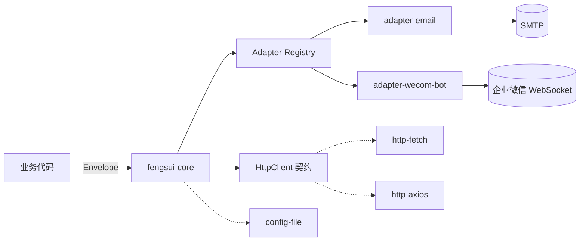

<div align="center">
  

  <h1>烽燧 · fengsui</h1>

  <p><strong>一封信封，万里相传。</strong></p>

  <p><sub>One envelope, every channel.</sub></p>

  <p>以信封为中心、插件化的多渠道消息投递框架</p>

  <p>
    <a href="https://www.npmjs.com/package/@javen205/fengsui-core"></a>
    <a href="https://www.npmjs.com/package/@javen205/fengsui-adapter-email"></a>
    <a href="https://www.npmjs.com/package/@javen205/fengsui-adapter-wecom-bot"></a>
    =22" />
  </p>
</div>

## 项目简介

两千年前，戍卒在烽火台上点燃柴薪，信号沿着山脊一座座传下去。点火的人不需要知道下一座台子用什么燃料，只需要表达一件事：**有消息，往哪里传。**

烽燧把这件事搬进代码里。业务只写一封信封：

```ts
await fengsui.send({
  channel: 'email.qq',
  action: 'send',
  target: { to: ['ops@example.com'] },
  content: { subject: '构建完成', text: '构建 #1234 已通过' },
  credentialsRef: 'tenant-a/qq-main',
});
```

至于是 SMTP、WebSocket 还是 HTTP，凭证从哪里取，失败了怎么重试、发不出去怎么降级——交给框架。

- **一封信封，统一表达**：`channel`、`action`、`target`、`content`、`meta` 五个字段描述一次投递，业务代码不关心底层协议。
- **渠道即插件**：核心不含任何渠道 SDK。装邮件才有 `nodemailer`，装企业微信才有长连接，按需引入、互不牵连。
- **配置给默认值**：默认渠道、凭证引用、发件人、项目继承链都可以预先配置，发送时只写业务字段。
- **失败是一等公民**：`validation` / `auth` / `network` / `rate_limited` 统一错误码，可重试标记、逐目标回执、幂等与 dry-run 开箱即用。

目前已支持**邮件**（通用 SMTP 与 QQ、Gmail、163、126、阿里云、新浪、Outlook、Microsoft 365 八个 preset）与**企业微信智能机器人**（多机器人长连接、入站 handler、主动推送）。

完整的安装、配置与渠道用法见 [文档](docs/guide/getting-started.md)。

## 设计架构

核心只做框架，渠道与传输都以插件形式接入：



- **core**：信封校验、能力协商、路由、重试/超时/fan-out、凭证解析、幂等、插件 API。
- **http**：只定义 `HttpClient` 契约；`http-fetch` 与 `http-axios` 是两种可互换实现。
- **config-file**：从 JSON 读取默认渠道、凭证引用与项目继承链，支持文件变更热刷新。
- **adapter-\***：渠道实现。新增渠道新建 `packages/adapter-*`，不在 core 内加实现。

分层细节、一封信的完整旅程与设计取舍见 [目录与架构](docs/guide/architecture.md)，扩展方式见 [如何扩展](docs/guide/extending.md)。

## 如何开发

环境要求：Node.js >= 22、pnpm。

```bash
pnpm install
pnpm build      # 构建全部 workspace 包
pnpm test       # 运行 Vitest 用例
pnpm lint       # ESLint
pnpm typecheck  # TypeScript 类型检查
pnpm docs:dev   # 本地预览文档站
```

目录：

```text
packages/
├── core/               # 信封、投递、凭证、配置、幂等、插件 API
├── http/               # HttpClient 契约
├── http-fetch/         # 原生 fetch 实现
├── http-axios/         # axios 实现
├── config-file/        # JSON 配置来源与文件监听
├── adapter-email/      # 邮件渠道
└── adapter-wecom-bot/  # 企业微信机器人
docs/                   # VitePress 文档
examples/               # 可运行示例
```

工程约定：

- **模块解析用 Bundler**：源码由 tsup 打包为自包含的 ESM/CJS 产物，无需 NodeNext 的 `.js` 后缀；类型检查与打包语义保持一致。
- **多包 workspace**：根 `package.json` 为 private，各包独立 `package.json` / `tsconfig` / `tsup.config`，内部依赖统一 `workspace:^`。
- **依赖收口**：`nodemailer` 只在邮件插件，`@wecom/aibot-node-sdk` 只在企业微信插件，`axios` 只作为 HTTP axios 插件的 peer。
- **测试**：`vitest.config.ts` 统一收集 `packages/*/test`，通过 alias 指向各包 `src`，无需先构建。

更多开发细节见 [快速开始 · 在仓库中开发](docs/guide/getting-started.md#在仓库中开发)。

## 如何贡献

欢迎 Issue 与 Pull Request。

1. 先搜一遍 [Issues](https://github.com/Javen205/fengsui/issues)，避免重复；新功能建议先开 Issue 对齐方案。
2. Fork 仓库，从 `dev` 切出分支：`feat/xxx`、`fix/xxx`、`docs/xxx`，PR 也请提交到 `dev`。
   `dev` 是默认开发分支，`master` 只用于发布，不接受直接提交。
3. 提交前确保 `pnpm lint`、`pnpm typecheck`、`pnpm test` 全部通过。
4. 新增渠道或传输请放到 `packages/adapter-*` / `packages/http-*`，不要在 core 中加入具体实现。
5. 提交信息遵循 Conventional Commits（`feat:`、`fix:`、`docs:`、`refactor:` 等）。
6. PR 描述写清：要解决的问题、实现思路、验证方式；涉及行为的改动同步更新 `docs/guide`。

小改动（错别字、文档、注释）可以直接提 PR，不必先开 Issue。
