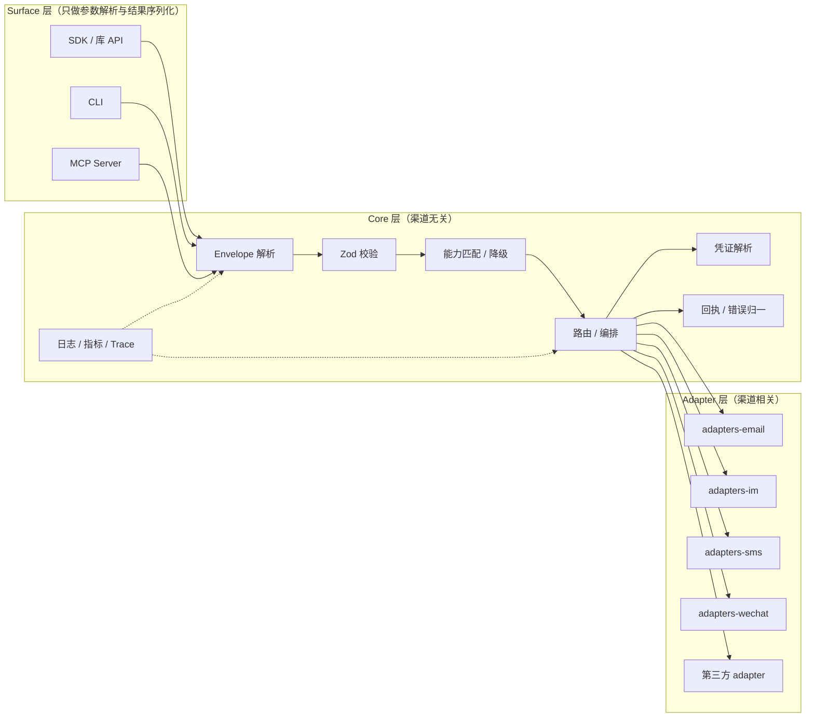
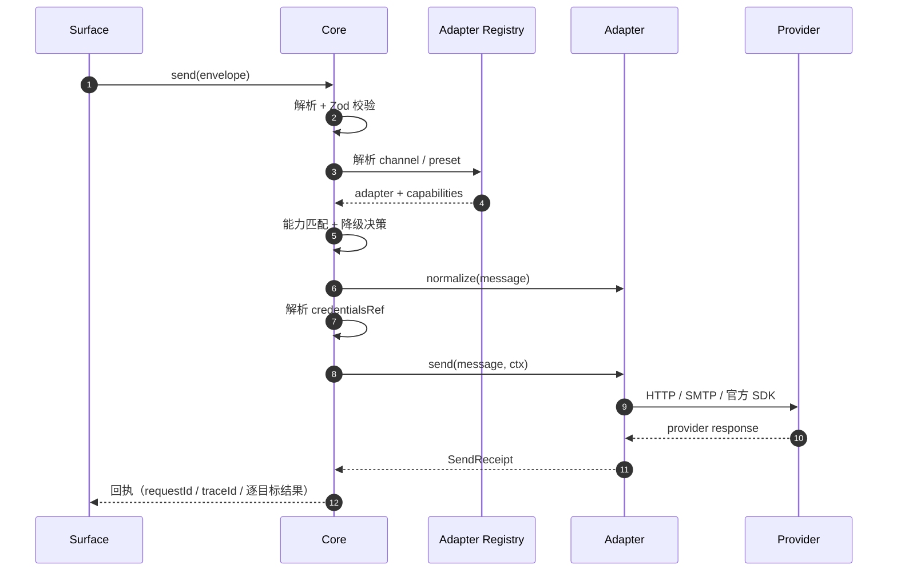
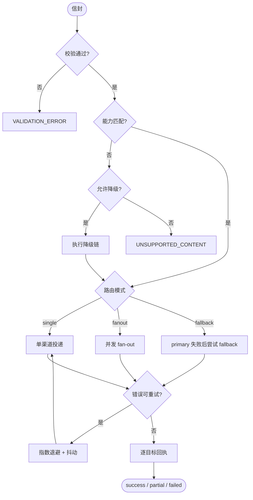

# fengsui（烽燧）完整设计方案

## 0. 结论摘要

- **架构**：Core（信封 → 校验 → 能力匹配 → 路由 → 投递 → 回执）与 Adapter、Surface（SDK / CLI / MCP）三层严格分离，三者共用同一套信封、能力模型与回执结构。
- **渠道**：用「provider preset + 通用 SMTP/IMAP 兜底」覆盖常用邮箱；IM 分 webhook 与应用消息两层；短信按「签名 + 模板 + 变量」建模；微信生态按模板/订阅/客服/素材拆分。
- **优先级**：P0 先做邮件 preset + 钉钉/企微/飞书 webhook + CLI；P1 做应用消息与阿里云/腾讯云短信；P2 做其余短信与公众号模板/订阅/客服；P3 做微信客服、素材管理与 Slack/Teams/Telegram/Discord 扩展。
- **技术栈**：Node.js 22/24 LTS + TypeScript strict + pnpm；`zod`、`nodemailer`、`@modelcontextprotocol/sdk`、`pino`、`commander` 等为正式依赖（`dependencies`，不拆包、不做可选 peer）；HTTP 传输默认用 Node 原生 `fetch`。
- **传输**：所有 HTTP/HTTPS 渠道统一经 Core 的 `HttpClient`；默认实现为 Node 20+ 原生 `fetch`，可注入 axios/undici/got/ky 实现；传输层只做单次请求 + 超时/取消，重试与熔断由 Core 投递器统一负责（见 1.9）。
- **企业级**：凭证三级来源（env → 本地加密文件 → KMS/Vault）、租户级 ACL 与令牌桶、指数退避 + 幂等键 + 死信重投、结构化日志/指标/Trace、库/CLI/MCP/容器四种部署形态。
- 渠道事实、配额与坑见 [channels-matrix.md](./channels-matrix.md)；已有渠道调研与竞品结论见 [message-channels-research.md](./message-channels-research.md)、[open-source-competitors.md](./open-source-competitors.md)。本文不重复这些内容。

## 1. 架构

### 1.1 三层同核



- **Core 不依赖任何渠道 SDK**：只依赖 `zod`、日志、指标与凭证解析接口。
- **Adapter 不解析 Surface 参数**：只接收已归一化的 `NormalizedMessage` 与 `SendContext`。
- **Surface 不实现业务**：只负责 CLI 参数、MCP 工具 schema、SDK 函数签名与回执序列化，避免「CLI 能发、MCP 不能发」的分叉。

| Surface | 入口约定 | 参数 | 输出 |
|---|---|---|---|
| SDK | `createFengsui(config)` + `fengsui.send(envelope)` | 直接传信封对象 | `SendReceipt`；失败抛 `FengsuiError` |
| CLI | `fengsui send --json @payload.json`，支持 stdin；另有 `channels`、`health`、`dlq` 子命令 | 文件或标准输入的信封 JSON | stdout 单行 JSON 回执；退出码 0 成功、2 校验失败、3 鉴权失败、4 限流、5 渠道拒绝 |
| MCP | 工具 `send_message`、`list_channels`、`describe_channel` | 入参即信封；`list_channels` 返回能力声明 | `structuredContent` 返回回执；文本摘要供人阅读；错误映射为 MCP 工具错误 |

### 1.2 调用时序



关键约束：凭证只在 Core 的 `CredentialResolver` 中解析，以 `SendContext.credentials` 传给 adapter；信封内不得出现密码、授权码、webhook key、access_token。

### 1.3 统一信封

信封由 7 个业务字段 + `version` 组成；编排开关收进 `meta`，避免污染业务模型。

| 字段 | 必填 | 语义 | 跨渠道复用规则 |
|---|---|---|---|
| `version` | 否 | 信封版本，默认 `1` | 只有不兼容变更才递增；adapter 不各自定义版本 |
| `channel` | 是 | 渠道标识，字符串或数组 | 数组表示 fan-out；fallback 链放 `meta.routing` |
| `action` | 否 | `send` / `upload` / `query`，默认 `send` | 同一 action 语义跨渠道对齐；`query` 用于回执查询 |
| `target` | 视渠道 | 统一收件人容器：`to` / `cc` / `bcc` / `userIds` / `chatId` / `phoneNumbers` / `openIds` | 公共字段放这里；渠道特有 ID 类型由 adapter 映射 |
| `content` | 是 | 可移植内容：`title` / `text` / `markdown` / `html` / `attachments` / `mentions` / `data` / `url` | 只放「换渠道仍成立」的内容；不得放卡片 JSON 或厂商字段 |
| `channelOptions` | 否 | 渠道私有参数：`templateId`、`signName`、`agentId`、`msgType`、`card`、`at`、`safe` 等 | 只影响当前渠道；未知字段一律拒绝 |
| `credentialsRef` | 是 | 凭证引用，格式 `tenant/account` | 禁止内联密钥；由 Core 解析成凭证对象 |
| `meta` | 否 | 追踪与控制：`requestId`、`idempotencyKey`、`traceId`、`tags`、`options`、`routing` | `options` 放 `dryRun`/`fallback`/`timeoutMs`；`routing` 放模式与降级链 |

**内容分层规则**

- `content`：主题、正文、Markdown、HTML、附件、@ 名单、模板变量、跳转 URL。目标是「同一份内容能尽量投递到多个渠道」。
- `channelOptions`：模板 ID、签名、应用 ID、消息类型、卡片结构、接收人 ID 类型、安全设置、重复检查开关。目标是「不把厂商私有结构泄漏到核心模型」。
- **确定不加 `content.card`**：卡片、模板、图文等结构化内容一律放 `channelOptions`（如 `card`、`templateId`），信封结构保持稳定不再扩展。原因是卡片结构强绑定厂商（钉钉 actionCard、企微 template_card、飞书 interactive），放进 `content` 会让「可移植内容」失去跨渠道语义；降级时由 adapter 把卡片内容转成 markdown/text 摘要，而不是让 Core 理解卡片结构。
- `attachments` 统一用 `{ name, path?, url?, contentType?, size? }`；adapter 负责上传并换成 `media_id`/`file_key`/`media_id`。
- `mentions` 统一用 `{ userIds?: string[]; all?: boolean; emails?: string[] }`；adapter 负责转成 `<at>`、`mentioned_list` 或文本前缀。

```json
{
  "version": 1,
  "channel": "email.qq",
  "action": "send",
  "target": { "to": ["ops@example.com"], "cc": [], "bcc": [] },
  "content": {
    "title": "构建完成",
    "text": "构建 #1234 已通过",
    "html": "<b>构建 #1234 已通过</b>",
    "attachments": [{ "name": "report.pdf", "path": "./report.pdf" }]
  },
  "channelOptions": { "replyTo": "ops@example.com" },
  "credentialsRef": "tenant-a/qq-main",
  "meta": {
    "requestId": "req-1",
    "idempotencyKey": "build-1234",
    "traceId": "00-4bf92f3577b34da6a3ce929d0e0e4736-00f067aa0ba902b7-01",
    "options": { "dryRun": false, "fallback": "degrade", "timeoutMs": 15000 },
    "routing": { "mode": "single" }
  }
}
```

### 1.4 能力声明与降级

```ts
export interface ChannelCapabilities {
  messageKinds: ReadonlyArray<'text' | 'markdown' | 'html' | 'card' | 'template' | 'media'>;
  attachments: false | {
    maxBytes: number;
    kinds: ReadonlyArray<'image' | 'file' | 'audio' | 'video'>;
  };
  mentions: false | { userIds: boolean; all: boolean; emails?: boolean };
  batch: false | { maxRecipients: number };
  templates: boolean;
  receipts: 'sync' | 'query' | 'callback' | 'none';
  rateLimit: {
    scope: 'tenant' | 'account' | 'bot' | 'recipient';
    perMinute?: number;
    perDay?: number;
  };
  idempotency: 'native' | 'local' | 'none';
  dryRun: boolean;
}
```

发送前由 Core 做能力匹配，`meta.options.fallback` 决定拒绝还是降级：

| 原内容 | 降级链 | 说明 |
|---|---|---|
| `html` | `html → markdown → text` | 邮件保留 HTML；IM 默认降为 Markdown，再不支持则纯文本 |
| `markdown` | `markdown → text` | 去掉标题、链接语法，只保留可读文本 |
| `card` | `card → markdown → text` | 卡片结构只放 `channelOptions.card`；不支持时降级并在回执标记 |
| `attachments` | `attachments → url 链接 → reject` | 只有在有可访问 URL 时才允许降级为链接；本地文件不能静默丢弃 |
| `mentions` | `mentions → 文本前缀 → 忽略` | @ 能力不支持时，按 `fallback` 决定加前缀或忽略 |
| `template` | `template → text` | 仅限允许自由文本的渠道；国内短信必须保留模板，缺失直接拒绝 |

```ts
export type DegradeDecision =
  | { kind: 'as-is' }
  | { kind: 'degraded'; from: string; to: string; reason: string }
  | { kind: 'rejected'; code: 'UNSUPPORTED_CONTENT'; detail: string };
```

降级必须满足两个条件：`meta.options.fallback = "degrade"`，且目标渠道的 `capabilities()` 明确声明可接受降级后的类型。回执中必须带 `degraded: true` 与原始/最终类型，禁止静默丢内容。

### 1.5 Adapter 契约

```ts
import type { ZodType } from 'zod';

export type ChannelId =
  | `email.${string}`
  | `im.${string}`
  | `sms.${string}`
  | `wechat.${string}`;

export interface ProviderPreset {
  id: string;
  endpoint: Record<string, string | number | boolean>;
  auth: 'password' | 'app-password' | 'oauth2' | 'access-token' | 'hmac' | 'webhook-key';
  notes?: string;
}

export interface Attachment {
  name: string;
  path?: string;
  url?: string;
  contentType?: string;
  size?: number;
}

export interface Mentions {
  userIds?: string[];
  all?: boolean;
  emails?: string[];
}

export interface Target {
  to?: string[];
  cc?: string[];
  bcc?: string[];
  userIds?: string[];
  chatId?: string;
  phoneNumbers?: string[];
  openIds?: string[];
  departmentIds?: string[];
  tagIds?: string[];
}

export interface PortableContent {
  title?: string;
  text?: string;
  markdown?: string;
  html?: string;
  attachments?: Attachment[];
  mentions?: Mentions;
  data?: Record<string, string>;
  url?: string;
}

export type ErrorCategory =
  | 'validation' | 'unsupported_content' | 'auth' | 'rate_limit'
  | 'recipient' | 'provider' | 'network' | 'timeout' | 'internal';

export interface ChannelError {
  code: string;
  category: ErrorCategory;
  retryable: boolean;
  retryAfterMs?: number;
  providerCode?: string;
  message: string;
}

export interface NormalizeContext {
  tenantId: string;
  locale?: string;
}

export interface SendContext {
  requestId: string;
  traceId: string;
  tenantId: string;
  credentials: Readonly<Record<string, string>>;
  signal: AbortSignal;
  logger: Logger;
  now(): Date;
}

export interface NormalizedMessage<TOptions = unknown> {
  channel: ChannelId;
  action: 'send' | 'upload' | 'query';
  target: Target;
  content: PortableContent;
  options: TOptions;
  idempotencyKey?: string;
}

export interface SendReceipt {
  channel: ChannelId;
  ok: boolean;
  requestId: string;
  providerMessageId?: string;
  acceptedCount?: number;
  invalidRecipients?: string[];
  degraded?: boolean;
  dryRun?: boolean;
  retryAfterMs?: number;
  error?: ChannelError;
}

export interface HealthStatus {
  ok: boolean;
  checkedAt: string;
  latencyMs?: number;
  detail?: string;
}

export interface ChannelAdapter<TOptions = unknown> {
  readonly id: ChannelId;
  readonly presets: Readonly<Record<string, ProviderPreset>>;
  capabilities(): ChannelCapabilities;
  readonly schema: ZodType<TOptions>;
  normalize(input: unknown, ctx: NormalizeContext): NormalizedMessage<TOptions>;
  send(message: NormalizedMessage<TOptions>, ctx: SendContext): Promise<SendReceipt>;
  sendBatch?(
    messages: ReadonlyArray<NormalizedMessage<TOptions>>,
    ctx: SendContext
  ): Promise<ReadonlyArray<SendReceipt>>;
  healthCheck(ctx: Pick<SendContext, 'credentials' | 'signal' | 'now'>): Promise<HealthStatus>;
}
```

- `presets`：邮件 provider 的默认端点与鉴权方式；`email.smtp` 的 `presets` 为空，走手工配置。
- `schema`：只校验 `channelOptions` 与该渠道特有字段；公共字段由 Core 的 `BaseEnvelope` 校验。
- `normalize`：把信封映射为 adapter 内部结构，完成 target/content 的渠道化，不发起网络请求。
- `send`：只负责凭证使用、媒体上传、请求发送与响应归一化；所有 HTTP 请求必须经 Core 的 `HttpClient`（见 1.9），禁止直接调用 `fetch`、`axios` 或 `https.request`；不得抛原始 SDK 异常。
- `sendBatch`：有原生批量能力的渠道实现；没有则由 Core 循环调用 `send`，并做并发上限。
- `healthCheck`：供企业运维拨测；不发送真实消息，只做鉴权/端点连通性检查。

**短信渠道族抽象**

短信不为每家厂商设计一套对外模型；`adapters-sms` 内部定义统一的 `SmsProvider`，`sms.aliyun` / `sms.tencent` 等只是 provider 实现：

```ts
export interface SmsSendInput {
  phoneNumbers: string[];
  signName: string;
  templateId: string;
  templateParams: Record<string, string>;
}

export interface SmsReceipt {
  providerMessageId?: string;
  acceptedCount: number;
  invalidPhoneNumbers?: string[];
}

export interface SmsStatus {
  state: 'submitted' | 'delivered' | 'failed' | 'unknown';
  providerCode?: string;
  detail?: string;
}

export interface SmsProvider {
  readonly id: 'aliyun' | 'tencent' | 'huawei' | 'yunpian' | 'submail';
  send(input: SmsSendInput, ctx: SendContext): Promise<SmsReceipt>;
  query?(providerMessageId: string, ctx: SendContext): Promise<SmsStatus>;
  parseCallback?(payload: unknown): SmsStatus;
}
```

- **选型**：阿里云 / 腾讯云作为默认双供应商，文档、批量与回执最完整；华为云适合已有华为云生态或政企客户；云片 / Submail 适合中小规模或国际短信。
- **回执/上行**：`query` 用于主动查询；`parseCallback` 统一解析状态回调与上行事件，进入审计/队列；未开通上行的厂商不实现该方法，状态返回 `unknown`。
- **切换成本**：业务信封不变，只改 `channel` 与 `credentialsRef`；模板 ID、签名放 `channelOptions`，不同厂商的模板需各自报备。

**凭证解析**：Core 的 `CredentialResolver` 按 `credentialsRef` 读取三级来源，返回 `Record<string, string>`；adapter 只看到已解析的字段（如 `username`、`password`、`clientId`、`clientSecret`、`webhookKey`），不接触存储实现。

**当前实现（Core 骨架）**

`src/core/adapter/types.ts` 先落地最小契约，与上面的完整设计存在以下差异，待接入真实渠道 adapter 时再补齐：

- `id` 为普通字符串（`domain.action`），暂不引入 `ChannelId` 模板字面量类型与 `ProviderPreset`。
- `send` 返回 `DeliveryReceipt | ChannelSendResult`；`ChannelSendResult` 是单目标轻量结果，避免 adapter 依赖 Core 的回执汇总逻辑。
- 上下文统一为 `AdapterContext`（`http` / `credentials` / `logger` / `signal` / `traceId` / `tenantId`），每次投递尝试传入独立的 `AbortSignal`；暂不暴露 `now`。
- 降级链由 adapter 顶层 `fallbacks` 声明（如 `html → markdown → text`），Core 仅在 `capabilities()` 允许降级后的类型时采用；`meta.options.fallback = "reject"` 时直接返回 `unsupported`。
- `normalize` 入参为 `AdapterNormalizeInput`（信封、单目标、已降级内容、已校验的 channelOptions），不再使用 `NormalizeContext`。
- 凭证解析当前只有 `EnvCredentialResolver`：`tenant-a/qq-main` 读取 `FENGSUI_CRED_TENANT_A_QQ_MAIN`，值可为 JSON 对象或单值；加密文件与 KMS/Vault 留待企业级阶段。

**邮件 adapter（第一批真实实现，`src/adapters/email/`）**

- `email.smtp` 是唯一发送实现，`email.qq` / `email.gmail` / `email.163` / `email.126` / `email.aliyun` / `email.sina` / `email.outlook` / `email.m365` 只提供 `host` / `port` / `secure` / 默认认证方式的 preset，不复制发送逻辑。
- preset 表以 `EMAIL_PRESETS` 独立导出，adapter 实例不挂 `presets` 字段；`channelOptions.transport` 可覆盖 host/port/secure。
- 发件人、`replyTo` 与自定义 headers 放在 `channelOptions`（`from` / `replyTo` / `headers`），不进入 `content`；`to` / `cc` / `bcc` 来自 `target`。
- 附件支持本地 `path` 与 `data:` URL（base64），`http(s)` 远程 URL 直接拒绝（SSRF），单附件上限 25MB。
- SMTP 错误映射：4xx → `network` 可重试；530/534/535 → `auth`；550/551/553/552/554 → `channel`；ETIMEDOUT/ECONNRESET/ENOTFOUND/ECONNREFUSED 等 → `network`；其余 → `channel` 不可重试，保留原始 code/response。
- `healthCheck` 调用 `transporter.verify()`；`email.smtp` 需在 `createEmailAdapter({ credentialsRef, transport })` 中提供端点。

### 1.6 路由与编排



| 模式 | 语义 | 适用场景 |
|---|---|---|
| `single` | 只投递一个渠道 | CLI 单发、SDK 指定渠道 |
| `fanout` | 多个渠道并发投递，逐目标回执，允许部分成功 | 告警同时发邮件/IM/短信 |
| `fallback` | primary 失败且错误可重试时，按 `meta.routing.chain` 依次尝试 | 邮件失败后补发短信/IM |

- **fan-out 默认并发 5**，避免瞬时打满渠道限流；每个目标独立超时、独立重试、独立回执。
- **fallback 只对可重试错误生效**：`network`、`timeout`、`provider`、`rate_limit`；`validation`、`auth`、`unsupported_content` 不自动 fallback，除非显式配置。
- **不做跨渠道事务**，也不回滚已成功的投递；`meta.routing.failFast` 只停止后续目标。
- 回执结构：

```json
{
  "requestId": "req-1",
  "status": "partial",
  "results": [
    { "channel": "email.qq", "ok": true, "providerMessageId": "<20261104...@qq.com>" },
    {
      "channel": "sms.aliyun",
      "ok": false,
      "error": {
        "code": "RATE_LIMITED",
        "category": "rate_limit",
        "retryable": true,
        "retryAfterMs": 30000
      }
    }
  ]
}
```

### 1.7 注册机制

- **内置 adapter：编译期注册**。`src/core/registry/` 维护 `Map<ChannelId, ChannelAdapter>`；内置 adapter 在 `src/adapters/*` 入口导出并注册，支持 tree-shaking，不扫描文件系统。
- **第三方 adapter：运行期显式加载**。配置中列出模块与版本，不做自动发现：

```ts
export default defineConfig({
  adapters: [
    { module: '@acme/fengsui-adapter-slack', id: 'im.slack.webhook', version: '^1.0.0' }
  ]
});
```

- **命名空间**：`<domain>.<vendor>.<surface>`，如 `im.dingtalk.robot`、`sms.aliyun`、`wechat.mp.template`；第三方必须使用自有 vendor 段，禁止占用内置 id。
- **版本约束**：内置 adapter 与 core 同包同版本，无需 peer 约束；只有第三方 adapter 声明兼容的 `fengsui` 版本范围，并在 `adapterCompat` 中声明支持的 envelope 版本；加载时校验，不匹配直接拒绝注册。
- **安全**：运行期加载只允许显式 allowlist，默认禁用；容器环境可通过 `FENGSUI_ADAPTERS_DIR` 限制目录。

### 1.8 反模式清单

| 反模式 | 竞品/常见做法 | fengsui 的对策 |
|---|---|---|
| 凭证塞 URL | Apprise 的 URL 配置模型 | 只允许 `credentialsRef`，schema 拒绝 `password`/`token`/`key` 字段 |
| 重中台化 | Novu 的 workflow/队列/订阅中心 | Core 保持无状态直发；工作流、审批、订阅偏好放到企业层或外部系统 |
| 每家渠道复制一套发送代码 | 多 provider 项目常见 | preset + 通用 adapter + 契约测试，渠道差异收进 `channelOptions` |
| 静默降级 | 很多聚合器直接丢附件 | 回执强制 `degraded`，降级链显式配置 |
| HTTP 200 即成功 | webhook 只看状态码 | 解析 `errcode`/`code`/`status`，映射统一错误码 |
| 渠道内散写 `fetch`/`axios` | 每个 adapter 各自请求 | 统一 `HttpClient`，可替换代理/TLS 与统一观测（见 1.9） |
| 所有错误都重试 | 简单重试导致重复打扰 | 只重试 `network`/`timeout`/`provider`/`rate_limit` |
| 日志记录正文与收件人 | 便于排查但泄露 PII | 只记录长度、SHA-256、脱敏后的目标 |
| 持久化原始信封 | 审计方便但存密钥 | 只存回执、内容哈希与审计字段 |

### 1.9 HTTP 传输层与可替换实现

**规则**：所有走 HTTP/HTTPS 的渠道（钉钉、企微、飞书、短信厂商、公众号/微信客服、素材上传、`access_token` 交换）必须通过 Core 的 `HttpClient`；adapter 内禁止直接调用全局 `fetch`、`axios`、`https.request` 或厂商 SDK 自带的 HTTP 栈。

**契约**

```ts
export interface HttpRequest {
  method: 'GET' | 'POST' | 'PUT' | 'PATCH' | 'DELETE';
  url: string;
  headers?: Record<string, string>;
  query?: Record<string, string | number | boolean | undefined>;
  body?: string | Uint8Array;   // 原始请求体；multipart 由 adapter 拼装并设置 Content-Type
  json?: unknown;               // 与 body 互斥；由传输层序列化并补 Content-Type
  timeoutMs?: number;
  signal?: AbortSignal;
  retryHints?: {
    idempotent: boolean;        // 只作提示，传输层不得据此重试
    retryAfterHeader?: string;  // 如 'retry-after'
    maxAttempts?: number;
  };
  meta?: {
    channel: ChannelId;
    tenantId: string;
    requestId: string;
    traceId?: string;
    operation?: string;         // 'token' | 'send' | 'upload' | 'query'
  };
}

export interface HttpResponse {
  status: number;
  headers: Readonly<Record<string, string>>;
  body: string;                 // 原始文本；传输层不解析业务错误码
  json(): unknown;              // 惰性 JSON.parse，由 adapter 按渠道 schema 收窄
  requestId: string;            // 本次调用 ID，来自 meta.requestId
  durationMs: number;
  truncated?: boolean;          // 响应体超过 maxResponseBytes
}

export interface HttpTransportError extends Error {
  category: 'network' | 'timeout' | 'internal';
  retryable: boolean;
  requestId: string;
}

export interface HttpClient {
  request(req: HttpRequest): Promise<HttpResponse>;
}

export interface FetchHttpClientOptions {
  defaultTimeoutMs?: number;    // 默认 15000
  maxResponseBytes?: number;    // 默认 2 MiB
}

export function createFetchHttpClient(options?: FetchHttpClientOptions): HttpClient;
```

- **非 2xx 不抛异常**，原样返回 `HttpResponse`，由 adapter 解析 `errcode`/`code`/`status`/`request_id`；只有网络错误、超时、响应超限才抛 `HttpTransportError`。
- `body` 必须是原始文本，保留渠道错误码与厂商 `request_id`；`headers` 小写归一，`set-cookie` 等多值头用逗号合并。
- `json` 与 `body` 互斥，同时传入按 `validation` 错误拒绝；`query` 由传输层编码，不手工拼 URL。

**注入**

```ts
const fengsui = createFengsui({
  http: createFetchHttpClient({ defaultTimeoutMs: 15000 })
});
```

```ts
const adapter = createDingtalkRobotAdapter({ http: customHttpClient });
```

优先级：adapter 构造参数 > `createFengsui({ http })` > 默认 `fetch` 实现。禁止通过环境变量隐式切换实现。

**可替换实现（示例，不随库发布）**

公共辅助函数（仅示例）：

```ts
function buildUrl(url: string, query?: HttpRequest['query']): string {
  if (!query) return url;
  const u = new URL(url);
  for (const [k, v] of Object.entries(query)) {
    if (v !== undefined) u.searchParams.set(k, String(v));
  }
  return u.toString();
}

function normalizeHeaders(input: Record<string, unknown>): Record<string, string> {
  return Object.fromEntries(
    Object.entries(input).map(([k, v]) => [
      k.toLowerCase(),
      Array.isArray(v) ? v.join(',') : String(v ?? '')
    ])
  );
}
```

axios：

```ts
import type { AxiosInstance } from 'axios';

export function createAxiosHttpClient(axios: AxiosInstance): HttpClient {
  return {
    async request(req) {
      const started = Date.now();
      const res = await axios.request({
        method: req.method,
        url: buildUrl(req.url, req.query),
        headers: req.headers,
        data: req.json ?? req.body,
        timeout: req.timeoutMs,
        signal: req.signal,
        responseType: 'text',
        transformResponse: [(raw) => raw],   // 保留原始文本
        validateStatus: () => true            // 非 2xx 不抛异常
      });
      const raw = typeof res.data === 'string' ? res.data : String(res.data);
      return {
        status: res.status,
        headers: normalizeHeaders(res.headers as Record<string, unknown>),
        body: raw,
        json: () => JSON.parse(raw),
        requestId: req.meta?.requestId ?? '',
        durationMs: Date.now() - started
      };
    }
  };
}
```

undici（代理、自定义 CA、HTTP/2 通过 `dispatcher` 配置）：

```ts
import { request as undiciRequest, type Dispatcher } from 'undici';

export function createUndiciHttpClient(options: { dispatcher?: Dispatcher } = {}): HttpClient {
  return {
    async request(req) {
      const started = Date.now();
      const res = await undiciRequest(buildUrl(req.url, req.query), {
        method: req.method,
        headers: req.headers,
        body: req.json !== undefined ? JSON.stringify(req.json) : req.body,
        signal: req.signal,
        headersTimeout: req.timeoutMs,
        bodyTimeout: req.timeoutMs,
        dispatcher: options.dispatcher
      });
      const raw = await res.body.text();
      return {
        status: res.statusCode,
        headers: normalizeHeaders(res.headers),
        body: raw,
        json: () => JSON.parse(raw),
        requestId: req.meta?.requestId ?? '',
        durationMs: Date.now() - started
      };
    }
  };
}
```

got（必须关闭默认重试）：

```ts
import got, { type OptionsInit } from 'got';

export function createGotHttpClient(defaults: OptionsInit = {}): HttpClient {
  return {
    async request(req) {
      const started = Date.now();
      const res = await got(buildUrl(req.url, req.query), {
        ...defaults,
        method: req.method,
        headers: req.headers,
        body: req.json !== undefined ? JSON.stringify(req.json) : req.body,
        timeout: { request: req.timeoutMs },
        signal: req.signal,
        retry: { limit: 0 },          // got 默认重试 2 次，必须关闭
        throwHttpErrors: false,
        responseType: 'text'
      });
      return {
        status: res.statusCode,
        headers: normalizeHeaders(res.headers),
        body: res.body,
        json: () => JSON.parse(res.body),
        requestId: req.meta?.requestId ?? '',
        durationMs: Date.now() - started
      };
    }
  };
}
```

ky（同样关闭默认重试）：

```ts
import ky from 'ky';

export function createKyHttpClient(defaults: Parameters<typeof ky.create>[0] = {}): HttpClient {
  const client = ky.create({ ...defaults, retry: 0, throwHttpErrors: false });
  return {
    async request(req) {
      const started = Date.now();
      const res = await client(buildUrl(req.url, req.query), {
        method: req.method,
        headers: req.headers,
        body: req.json !== undefined ? JSON.stringify(req.json) : req.body,
        signal: req.signal,
        timeout: req.timeoutMs
      });
      const raw = await res.text();
      return {
        status: res.status,
        headers: normalizeHeaders(Object.fromEntries(res.headers)),
        body: raw,
        json: () => JSON.parse(raw),
        requestId: req.meta?.requestId ?? '',
        durationMs: Date.now() - started
      };
    }
  };
}
```

**为什么不做内置多实现自动探测**

- 会把 axios/undici/got/ky 之一变成硬依赖，安装体积、供应链与 CVE 面扩大，违背「默认零依赖」。
- 各实现对代理、TLS、gzip、重定向、超时、连接池的处理不同；自动探测会让同一条消息在不同部署环境表现不一致，问题难以复现。
- 显式注入让排障路径唯一：日志固定记录 `httpClient` 实现名（`fetch` / `axios` / `undici` / `got` / `ky` / `custom`）。

**横切能力落点**

| 能力 | 落点 | 结论 |
|---|---|---|
| 超时 | 传输层 | `timeoutMs` 与 `signal` 用 `AbortSignal.any` 合并；默认 15s，可按渠道覆盖 |
| 取消 | 传输层 | 上层 `AbortSignal` 透传；Core 在超时或用户取消时统一 abort |
| 代理 | 替换实现 | 默认 `fetch` 不读 `HTTPS_PROXY`、不内置代理；企业代理注入 axios/undici，或在网关层终结 |
| 自定义 CA/TLS | 替换实现 | 默认只受 `NODE_EXTRA_CA_CERTS` 影响；需要 `ca`/`rejectUnauthorized` 时注入 axios/undici |
| 重试与退避 | Core 投递器 | 传输层只发一次，见下方结论 |
| 熔断 | Core 投递器 | 按 `tenant + channel + account` 维度；传输层无状态 |
| traceparent | Core 注入、传输层透传 | Core 写入请求头，传输层只把 `traceId` 带进日志 |
| 日志脱敏 | 传输层 + Core | 只记 method、去掉 query 的 path、status、duration；`authorization`/`cookie`/`token`/`key`/`sign` 记为 `[REDACTED]`；不记请求与响应 body |
| 响应体上限 | 传输层 | 默认 2 MiB；流式读取到上限即截断并标记 `truncated`，adapter 按 `provider` 错误处理 |
| HTTP/2 与 keep-alive | 传输层 | 默认 `fetch` 为 HTTP/1.1 + keep-alive；需要 h2 时注入 undici（`allowH2`）或经网关 |

**重试放在渠道层还是传输层**

结论：**都放 Core 投递器，传输层只做单次请求 + 超时/取消**。

- 传输层若自带重试，会与 Core 的指数退避叠加（3×3=9 次请求），放大限流与重复消息风险。
- adapter 只负责把响应映射为 `ChannelError`，是否重试由 Core 依据 `retryable`、`retryAfterMs`、幂等键与渠道配额决定。
- 第三方实现默认重试必须显式关闭：got `retry: { limit: 0 }`、ky `retry: 0`；axios 默认不重试。
- 幂等键由 Core 生成；adapter 映射到渠道原生字段（钉钉 `msgUuid`、飞书 `uuid`、企微 `duplicate_check`、邮件 `Message-ID`）。

**测试**

- 单元/契约：注入 `mockHttpClient`，断言 method/url/headers/body、错误映射与重试次数，不触网。
- 集成：`msw` 拦截默认 `fetch` 实现，验证序列化、超时、`truncated` 与脱敏；替换实现单独跑一组冒烟用例。
- 自定义 `HttpClient` 最小实现：

```ts
export function createMockHttpClient(
  handler: (req: HttpRequest) => Promise<HttpResponse>
): HttpClient {
  return { request: handler };
}

// 用法：模拟钉钉机器人返回业务错误码
const http = createMockHttpClient(async (req) => ({
  status: 200,
  headers: { 'content-type': 'application/json' },
  body: JSON.stringify({ errcode: 310000, errmsg: 'keywords not in content' }),
  json: () => ({ errcode: 310000, errmsg: 'keywords not in content' }),
  requestId: req.meta?.requestId ?? 'mock',
  durationMs: 1
}));
```

## 2. 技术栈与工程

### 2.1 运行时与版本策略

- **Node.js 22 / 24 LTS**：`engines.node >= 22`；CI 矩阵跑 22 与 24，发布基线为 22，推荐 24。
- **TypeScript 6.x strict**：`strict`、`noUncheckedIndexedAccess`、`exactOptionalPropertyTypes`、`verbatimModuleSyntax`；TS 7 暂缓，等 typescript-eslint 兼容后再升级。
- **pnpm**：锁文件提交，`packageManager` 固定 pnpm 版本；不使用 npm/yarn 混装。
- **ESM 优先**：源码与内部包用 ESM；对外同时产出 CJS，兼容旧工具链。

选择理由：

- **Node**：邮件库、IM/短信官方 SDK、MCP SDK 的生态最完整；发送是 I/O 密集型，异步模型合适；企业容器与 CI 普及，部署成本低。
- **TypeScript**：信封、adapter 契约、能力声明需要编译期约束；与 `zod` 的 schema 推导配合，减少运行时与文档漂移。
- **pnpm**：单包项目也用 pnpm 统一锁文件与依赖安装；后续若拆分发布再引入 workspace，当前不建 monorepo。
- **ESM 优先**：`@modelcontextprotocol/sdk` 与现代包以 ESM 为主；CJS 双出口只用于兼容旧项目，不作为主路径。

### 2.2 单包与目录划分

```text
fengsui/
├── src/
│   ├── core/                 # 信封、schema、能力、错误、凭证解析、脱敏
│   │   └── envelope/
│   ├── http/                 # HttpClient 类型与默认 fetch 实现
│   ├── adapters/             # 后续：email/im/sms/wechat，同一包内目录，不拆子包
│   ├── cli/                  # 后续：bin fengsui
│   ├── mcp/                  # 后续：bin fengsui-mcp（stdio / streamable HTTP / SSE）
│   └── index.ts              # 根入口
├── tests/                    # 单元、契约、集成测试
├── docs/
├── package.json              # exports: fengsui / fengsui/core / fengsui/http
├── pnpm-workspace.yaml       # pnpm 12 项目配置，仅用于 allowBuilds，不代表 monorepo
├── tsconfig.json
├── tsup.config.ts
└── vitest.config.ts
```

- **单包**：只发布一个 npm 包 `fengsui`，通过 `exports` 暴露 `fengsui`、`fengsui/core`、`fengsui/http`；不建 monorepo，不按渠道或按「邮件 / IM」拆分子包。
- **不拆依赖**：`zod`、`nodemailer` 以 `dependencies` 声明，不使用 `optionalDependencies`，也不把 `nodemailer` 设为可选 peer；后续 adapter 放在 `src/adapters/*`，随同一个包发布。
- **传输注入**：`fengsui/http` 定义 `HttpClient`，adapter 通过构造参数接收；`createFengsui({ http })` 提供全局默认实现（见 1.9）。
- **第三方 adapter**：只有外部 adapter 才声明兼容的 `fengsui` 版本范围，内置 adapter 与 core 同包同版本，不需要 peer 约束。

### 2.3 依赖清单

| 包 | 角色 | 是否可替换 |
|---|---|---|
| `zod` | 信封/渠道 schema、MCP 工具入参校验；正式依赖 | 可换 valibot，但 MCP 生态与示例以 zod 为主，建议保留 |
| `nodemailer` | 邮件 SMTP、MIME、附件、DKIM、OAuth2；正式依赖（`dependencies`，非可选 peer） | 不建议替换，成熟度最高 |
| `imapflow` | 收件/退信关联（v0.5+ 收件能力）；正式依赖 | 可换 emailjs-imap-client |
| `commander` | CLI 子命令与参数 | 可换 clipanion / yargs |
| `@modelcontextprotocol/sdk` | MCP server、stdio/HTTP transport、工具注册 | 不建议替换 |
| `pino` | 结构化 JSON 日志 | 可换 winston，但 pino 性能更好 |
| `vitest` | 单元/契约/集成测试 | 可换 jest |
| `msw` | webhook/HTTP provider mock | 可换 nock |
| `smtp-server` | 本地 SMTP 捕获，验证 MIME 与附件 | 仅测试用，不建议替换 |
| `tsup` | ESM+CJS+d.ts 构建 | 可换 tsc/rollup，但 tsup 配置更简单 |
| `@changesets/cli` | 版本与发布 | 可换 release-please |
| `dotenv` | 本地 `.env` 加载 | 可换 Node `--env-file` |
| `typescript` / `eslint` / `typescript-eslint` / `prettier` | 类型、lint、格式化 | lint 组合可替换 |
| `@types/node` | Node 类型 | 必备 |

**依赖原则**：`zod`、`nodemailer` 是正式依赖（`dependencies`），不做可选 peer，也不把邮件适配器拆成按需安装的子包；安装对应包即带齐运行时依赖。钉钉、企微、飞书、微信与短信厂商不引入官方 SDK，签名与 HTTP 请求统一经 `HttpClient`（见 1.9），便于替换代理/TLS 与统一观测。

原生能力：`fetch`（Node 20+ 内置，项目基线 22）、`AbortSignal.timeout` / `AbortSignal.any`、`node:crypto`（AES-256-GCM、HMAC-SHA256）、`node:fs/promises`。这些不增加依赖。

### 2.4 构建与发布

- **双格式**：`tsup` 输出 `dist/index.js`（ESM）与 `dist/index.cjs`（CJS），`dts: true`，保留 sourcemap。
- **exports map**：

```json
{
  "name": "fengsui",
  "type": "module",
  "exports": {
    ".": {
      "types": "./dist/index.d.ts",
      "import": "./dist/index.js",
      "require": "./dist/index.cjs"
    },
    "./core": {
      "types": "./dist/core/index.d.ts",
      "import": "./dist/core/index.js",
      "require": "./dist/core/index.cjs"
    },
    "./http": {
      "types": "./dist/http/index.d.ts",
      "import": "./dist/http/index.js",
      "require": "./dist/http/index.cjs"
    }
  },
  "files": ["dist"],
  "engines": { "node": ">=22" }
}
```

- **CLI / MCP 入口**：同一包的 `bin` 为 `{ "fengsui": "./dist/cli.js", "fengsui-mcp": "./dist/mcp.js" }`，脚本首行 `#!/usr/bin/env node`。
- **发布**：Changesets 管理单包版本；`0.x` 阶段允许 breaking，`1.0` 后遵守 semver；subpath 入口随同一次发布。
- **发布命令**：`pnpm changeset` → `pnpm changeset version` → `pnpm build` → `pnpm changeset publish`；npm 发布开启 provenance。

### 2.5 代码质量闸门与 CI

```bash
pnpm install --frozen-lockfile
pnpm lint
pnpm typecheck
pnpm test -- --coverage
pnpm build
pnpm audit --prod
pnpm changeset status --since=origin/main
```

CI 步骤：

1. Node 22 / 24 矩阵，缓存 pnpm store。
2. `lint` + `typecheck`，失败即阻断。
3. `test` 覆盖率阈值：`core` ≥ 80%，`adapters-*` ≥ 70%，`cli`/`mcp` ≥ 60%。
4. `build` 后做包体检查：`exports` 可解析、`bin` 可执行、CJS/ESM 双入口可导入。
5. `audit --prod` 仅阻断 high/critical；低危记录到周报。
6. PR 必须有 changeset；发布分支跑 `changeset publish --dry-run`。

## 3. 企业级落地

### 3.1 凭证与密钥

三级来源，优先级从高到低：

1. **环境变量**：`FENGSUI_<TENANT>_<ACCOUNT>_<FIELD>`，适合 CI/容器/K8s Secret。
2. **本地加密文件**：`~/.config/fengsui/credentials.json`，权限 `0600`；AES-256-GCM，主密钥来自 `FENGSUI_MASTER_KEY`（32 字节 base64）或系统钥匙串。
3. **企业密钥管理**：`SecretProvider` 接口对接 Vault、阿里云 KMS、AWS KMS；Core 只依赖接口，不绑定厂商。

```ts
export interface SecretProvider {
  get(ref: string): Promise<string | undefined>;
  set?(ref: string, value: string): Promise<void>;
  rotate?(ref: string): Promise<void>;
}
```

- 加密文件只存 `iv`、`tag`、`ciphertext`、`version`、`kdf` 元数据，不存明文。
- `credentialsRef` 以 `tenant/account` 隔离；跨租户引用直接拒绝。
- 日志脱敏规则：`authorization`、`access_token`、`token`、`secret`、`key`、`sign`、`appkey`、`password`、`cookie` 一律替换为 `[REDACTED]`；手机号保留前 3 后 2，邮箱保留首字符与域名。
- 错误信息中的 URL 查询参数、请求头、响应体中的密钥字段统一清洗后再上报。

**审计日志字段**：`timestamp`、`tenantId`、`requestId`、`traceId`、`surface`（sdk/cli/mcp）、`channel`、`action`、`targetHash`、`contentHash`、`contentBytes`、`result`、`errorCode`、`providerMessageId`、`retryCount`、`durationMs`。不记录正文、附件内容与原始收件人。

### 3.2 多租户与权限

- **租户来源**：由 Surface 的认证主体解析（CLI profile、MCP OAuth/token、SDK config），不信任信封里的 `meta.tenantId`。
- **隔离模型**：凭证按 `tenant/account` 命名空间隔离；配额、审计、死信、限流桶都带 `tenantId`。
- **渠道级授权**：租户可配置 `allowedChannels`；未授权渠道在 Core 直接拒绝，不进入 adapter。
- **配额与限流**：令牌桶按「租户 + 渠道 + 账号 + 收件人」四层；默认内存实现，集群用 Redis；超限返回 `RATE_LIMITED` + `retryAfterMs`。
- **发送审批/白名单**：生产环境开关 `policy.productionRecipientsOnly`，只允许白名单域名；外部域名可要求 `policy.requireApproval`，进入 outbox 等待审批。
- **数据边界**：租户配置、凭证、死信、审计按 `tenantId` 分区；MCP HTTP 模式必须校验 token 对应的租户。

### 3.3 可靠性

| 机制 | 策略 |
|---|---|
| 超时 | 邮件 30s；webhook 10s；短信 10s；微信 15s；可用 `meta.options.timeoutMs` 覆盖 |
| 重试 | 最多 3 次；指数退避 `min(30s, 500ms × 2^n)`；抖动 ±20%；只重试可重试错误 |
| 幂等 | 优先原生：钉钉 `msgUuid`、飞书 `uuid`、企微 `duplicate_check`、邮件 `Message-ID`；无原生能力用本地去重（TTL 24h） |
| 限流退避 | 读取 `Retry-After` / `retryAfterMs`；无该字段按渠道配额估算；退避期间不占用并发槽 |
| 死信 | 超过重试上限写入 JSONL（默认 `~/.local/state/fengsui/dlq.jsonl`）或 Redis；`fengsui dlq list/replay` 重投 |
| 熔断 | 同一账号连续 5 次失败打开 60s；半开时 `healthCheck`；鉴权失败直接标记凭证失效 |
| 粘性失败 | 配置错误/鉴权失败不重试，返回明确修复建议；凭证轮换后自动恢复 |

**错误分类**

| category | 典型场景 | 可重试 |
|---|---|---|
| `validation` | 字段缺失、未知字段、字节超限 | 否 |
| `auth` | 授权码错误、token 失效、IP 不在白名单 | 否（需修配置/轮换） |
| `rate_limit` | 20 条/分钟、日额度、并发限流 | 是（按 `retryAfterMs`） |
| `recipient` | `invaliduser`、`81013`、全部收件人无效 | 否（部分无效可逐目标重投） |
| `unsupported_content` | 渠道不支持 HTML/附件/@ | 否（可显式降级） |
| `provider` | 5xx、厂商内部错误、模板未审核 | 视错误码；5xx 可重试 |
| `network` | DNS、连接重置、TLS 失败 | 是 |
| `timeout` | 请求超时 | 是 |
| `internal` | 代码缺陷、序列化失败 | 否 |

### 3.4 可观测性

- **日志**：`pino` JSON；字段包含 `requestId`、`traceId`、`tenantId`、`channel`、`action`、`durationMs`、`result`、`errorCode`；正文只记 `contentBytes` 与 `contentHash`。
- **指标**：`fengsui_send_total{channel,status}`、`fengsui_send_duration_ms{channel}`（P50/P95/P99）、`fengsui_provider_errors_total{channel,code}`、`fengsui_rate_limit_remaining{channel}`、`fengsui_dlq_size{tenant}`。
- **追踪**：SDK/CLI/MCP 入口生成或透传 W3C `traceparent`；`meta.traceId` 可覆盖；MCP 回执带 `traceId` 便于串联。
- **dry-run**：`meta.options.dryRun = true` 时不调用 provider，返回模拟回执（`dryRun: true`、`providerMessageId: "dry-run"`），仍执行 schema、能力与凭证存在性校验。
- **沙箱**：`FENGSUI_SANDBOX=1` 时强制使用 mock endpoint 或测试账号；生产凭证在沙箱模式下拒绝加载。

### 3.5 部署形态

| 形态 | 入口 | 适用场景 |
|---|---|---|
| 库嵌入 | `createFengsui(config)` + `fengsui.send()` | 业务服务内直接调用，最低延迟 |
| CLI | `fengsui send --json @payload.json` | 脚本、CI、运维手动补发 |
| MCP stdio | `fengsui-mcp --stdio` | 本地 IDE/Agent 集成 |
| MCP HTTP | `fengsui-mcp --http 0.0.0.0:8080`（Streamable HTTP，兼容 SSE） | 远程 Agent、团队共享 |
| 容器 | `ghcr.io/<org>/fengsui:<version>` | 独立服务、K8s、多租户网关 |

```yaml
services:
  fengsui:
    image: ghcr.io/your-org/fengsui:0.3
    command: ["fengsui-mcp", "--http", "0.0.0.0:8080"]
    env_file: .env
    ports:
      - "8080:8080"
    volumes:
      - fengsui-data:/data
    healthcheck:
      test: ["CMD", "fengsui", "health", "--json"]
      interval: 30s
      timeout: 5s
      retries: 3
volumes:
  fengsui-data:
```

最小运行要求：CLI/SDK 单核 256MB 内存即可；MCP HTTP + Redis + 指标约 1 vCPU / 512MB；镜像基于 `node:22-slim` 或 distroless，非 root 运行，只读根文件系统，`/data` 持久化。

### 3.6 安全与合规

- **密钥**：不落日志、不进信封、不进回执；本地文件 `0600`；KMS/Vault 优先；轮换不重启（`SecretProvider.rotate`）。
- **PII**：收件人、手机号、邮箱、正文摘要脱敏；错误上报前清洗；审计只存哈希。
- **大小限制**：邮件附件默认 25MB（可按 provider 调整）；IM 图片/文件按渠道上限；短信 500 字；微信素材按官方上限；超限在 Core 拒绝。
- **审计留存**：默认 180 天，可配置；只存回执与哈希，不存正文/附件。
- **国内合规**：短信签名与模板需实名报备、营销短信发送时间受限；公众号订阅消息必须用户主动授权；企微应用消息需可信 IP 与可见范围；钉钉 webhook 建议加签 + IP 白名单；跨境场景注意数据驻留。

### 3.7 版本路线图与 DoD

| 版本 | 范围 | DoD（验收标准） |
|---|---|---|
| v0.1 | Core + 邮件 preset + CLI + dry-run | 9 个邮件 channel id 可配置；schema/降级/错误映射单测通过；`smtp-server` 捕获 MIME 与附件；CLI 退出码稳定 |
| v0.2 | 钉钉/企微/飞书 webhook + fan-out | 加签/关键词/IP 校验；20 条/分钟限流回执；`@` 与降级可验证；多渠道路由部分成功回执 |
| v0.3 | 钉钉工作通知、企微应用消息、飞书应用机器人 + 阿里云/腾讯云短信 | token 缓存与失效重试；批量/模板/媒体上传；逐目标回执与状态查询 |
| v0.4 | 其余短信 + 公众号模板/订阅/客服 | 模板/签名校验；48 小时窗口与条数额度；素材上传与 `media_id` 复用；订阅授权校验 |
| v0.5 | 微信客服、素材管理、MCP HTTP、多租户/ KMS/ DLQ/ 指标 | MCP stdio 与 HTTP 同一信封；租户隔离；Vault/KMS 接入；死信可重投；P99 指标可见 |
| v1.0 | API 冻结、全渠道、插件 SDK、文档与迁移指南 | 信封 v1 冻结；adapter 契约测试全覆盖；破坏性变更需 major；发布 provenance 与迁移文档 |

## 4. 测试与验证

### 4.1 分层策略

| 层级 | 范围 | 工具与断言 |
|---|---|---|
| 单元 | schema、能力匹配、降级链、错误映射、脱敏、令牌桶 | `vitest`；表驱动用例；覆盖率 core ≥80% |
| 传输 | 默认 `fetch` 实现、mock 注入、序列化、超时、响应截断、脱敏 | `vitest`；注入 `mockHttpClient` 断言原始请求；`msw` 仅验证默认实现；全程不触网 |
| 契约 | 每个 adapter 复用同一套 `runAdapterContractSuite` | 必测：合法信封、未知字段、缺凭证、能力缺失、provider 错误、限流、超时、幂等、批量、dry-run |
| 集成 | 邮件 `smtp-server` 捕获；webhook 本地 `msw` mock；短信/微信 HTTP mock | 断言 MIME、附件名/大小、签名串、`errcode` 映射、重试次数 |
| Live | 默认关闭；`FENGSUI_LIVE_TEST=1` 且指定测试账号 | 只向自己的邮箱/群/测试号码发送固定消息；CI 永不开启；失败只告警不阻断 |

契约测试示例：

```ts
runAdapterContractSuite(adapter, {
  validEnvelope,
  invalidEnvelopes: [missingTarget, unknownOption, oversizeContent],
  providerErrors: [authError, rateLimitError, serverError],
  expectedCapabilities,
  fixtures: { attachments, mentions, templates }
});
```

### 4.2 新渠道接入检查单

- [ ] `channel id` 符合命名空间，未与内置冲突；`presets` 有官方文档依据。
- [ ] `capabilities()` 与真实能力一致；不支持的能力明确为 `false`，不夸大。
- [ ] `schema` 拒绝未知字段；必填/互斥项有测试；字节上限有测试。
- [ ] `normalize()` 不发起网络请求；target/content 映射有快照测试。
- [ ] `send()` 不抛原始 SDK 异常；所有错误映射到统一 `category`。
- [ ] 凭证缺失、过期、IP 不在白名单有明确错误码与修复建议。
- [ ] 限流、超时、5xx 可重试；`retryAfterMs` 正确解析。
- [ ] 幂等键映射到渠道原生能力；无原生能力时本地去重有测试。
- [ ] 附件/媒体上传路径、大小限制、失败回滚有测试。
- [ ] `healthCheck()` 不发送真实消息，只验证鉴权与端点。
- [ ] 契约测试全绿；集成 mock 覆盖成功/失败/限流；文档与官方链接可访问。

## 5. 渠道覆盖与优先级

| 层级 | 渠道 | 版本 | 选择理由 |
|---|---|---|---|
| P0 | 邮件 9 个 preset（QQ/Gmail/163/126/Outlook/M365/阿里/新浪/通用 SMTP）+ 钉钉/企微/飞书 webhook + CLI | v0.1–v0.2 | 无企业应用审核、最快验证信封与错误模型；邮件覆盖附件/HTML，webhook 覆盖告警 |
| P1 | 钉钉工作通知、企微应用消息、飞书应用机器人 + 阿里云/腾讯云短信 | v0.3 | 可定向到人/部门，满足企业通知；短信覆盖验证码/告警 |
| P2 | 华为云/云片/Submail 短信 + 公众号模板/订阅/客服消息 + 素材 | v0.4 | 补齐国内主流短信与微信服务号场景 |
| P3 | 微信客服 Kf、素材管理增强、Slack/Teams/Telegram/Discord | v0.5+ | 独立客服体系与海外 IM，按需求接入，不改核心 |

各渠道的接入方式、鉴权、配额、坑与官方链接见 [channels-matrix.md](./channels-matrix.md)。

## 6. 需要拍板的开放问题

1. **P0 范围**：邮件与三家 IM webhook 是否同时首发，还是先只做邮件 + CLI，把 IM 放到 v0.2？这决定首个可交付版本的时间与验证面。
2. **是否做收件/双向能力**：IMAP 收件、退信关联、公众号/企微事件回调、短信上行是否纳入 v1.0？这会引入常驻 webhook server、状态存储与合规要求。
3. **多租户形态**：首发只做单租户库/CLI，还是从 v0.3 就提供多租户 MCP HTTP？后者需要 KMS、配额、审计与租户认证同步设计。
4. **凭证托管边界**：首发只支持 env + 本地加密文件，还是必须支持 Vault/KMS？企业客户通常要求后者，但会延长 v0.5 的交付周期。
5. **微信生态范围**：只做服务号模板/订阅/客服，还是把微信客服（Kf）与素材管理纳入首发？Kf 需要独立 Secret、客服账号体系与会话状态。
